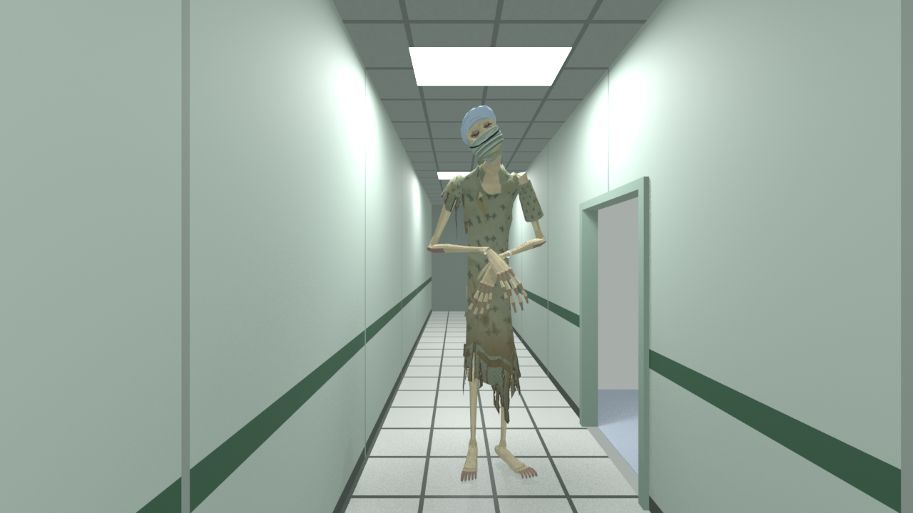

# Going Down

A co-op suspense game for Windows, with a browser build as the backup. A crew rides an elevator down through a building that gets worse on every floor, and gets paid for getting close to the things that live there.

The civilisation above never stopped building upward: hospitals on top of TV stations on top of storage halls, each new age laid over the last. You are convicts, sentenced to explore what is underneath. Earn enough down there and you buy your freedom.



*The Orderly, first pass. It gets a second one.*

**[The first browser version](https://jbarnell1.github.io/going-down/)** is still published and is no longer changed. The game has since moved to the Godot engine and is played from a downloaded Windows build with a small server at home.

> **Status, 18 November 2026: playable with friends, still being built.** Three places (a clinic, an endless office, a soft-play area), each with its own resident and its own rule; a lift, a floor quota and a day quota; a prison to come home to; an announcer; live settings for the host. A fourth place, a dark forest indoors, is being built. This repository is built in the open by an AI-assisted work loop, one verified step at a time. "Going Down" is a working title.

## The idea

- **Barely able to fight back.** No weapons. The most you have is a flare that buys a few seconds.
- **Dread you can see coming.** Every entity is heard before it is seen, and seen before it can reach you.
- **Nobody survives alone.** Up to eight players, built around four. A downed player moves to the cameras and keeps playing.
- **Greed drives the run.** Pay comes from readings, and the instrument only records the scary part. After every floor the crew votes: bank it, or ride down.
- **Trust nothing but each other.** The deeper you go, the less two players see the same floor.
- **Scream, then laugh.** A relentlessly cheerful elevator voice narrates all of it.
- **Never the same twice.** Every floor is a different place built from a seed: a clinic with every light on, an endless yellow office, a forest indoors.

Entities follow rules they never break. Learning the rule is how you survive, and testing it is how you get paid.

## How it is built

| Part | Choice |
|---|---|
| Game | Godot 4.7.2, typed GDScript, one codebase. First-person, under a low-resolution tape-playback look. |
| Multiplayer | A small dedicated server at home runs the rules and keeps everyone in step. Playing alone runs the same rules inside the game. |
| Rules | A pure logic layer with no drawing and no network, so hundreds of runs can be simulated in tests. Every rule change sits behind a flag. |
| Characters | Modelled, rigged and animated in Blender by script. Each script rebuilds its figure from nothing. |
| Checks | Rule tests on every commit, scripted playthroughs of the real game on every build, a secret scan on every commit, CI on a clean Linux machine. |

### Where things are

- `AGENTS.md` : the rules for any coding agent working here. Start with it.
- `godot/` : the game. `sim/` the rules, `net/` the network, `server/` the home server, `client/` what you see and hear, `tests/`, `tools/`. See `godot/README.md`.
- `loop/` : how the work is run. `LOOP.md` is the rulebook for one iteration, `ENDPOINT.md` is the list of gates that define "done", and `PROGRESS.md` is the live state with evidence for every finished task.
- `docs/VOICE.md` : how the elevator voice is written and directed. `docs/ART-NOTES.md` : what was learned making the figures.
- `assets_src/` : the Blender scripts that build each character, their review renders, the voice scripts.
- `hub/` : a small local server for checking in on the latest build, the loop's status, and open design questions.
- `src/`, `tests/` : the first browser version in TypeScript. Frozen; kept as the reference the Godot rules were proved against.

## Running it

You need the Godot 4.7.2 engine. Point `GODOT` at its console build, then:

```bash
npm ci
node godot/tools/godot.mjs import
npm run godot:test -- --quick
npm run godot:export
```

The Windows build lands in `godot/export/windows/`. Open `godot/project.godot` in the editor to run it from source.

## Credits and inspirations

Mechanics here owe a debt to Lethal Company, R.E.P.O., Content Warning, Phasmophobia, Spooky's Jump Scare Mansion, The Mound: Omen of Cthulhu, Escape the Backrooms and PEAK, and to two friends' browser games that started this, [EmberDeep](https://github.com/DNDNoob/EmberDeep) and [Abyssal Garden](https://github.com/Noniv/abyssal-garden). The characters, places and look are this game's own.

Third-party assets and their licences are listed in `CREDITS.md` as they are added.

## Licence

[GNU Affero General Public License v3.0](LICENSE). You may use, change and share this, including over a network, as long as what you share stays open under the same licence.
